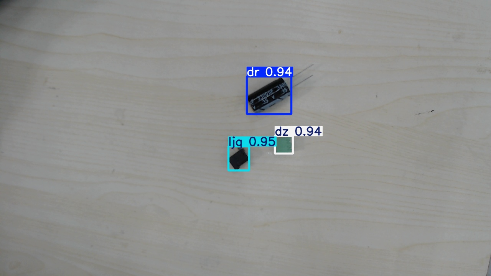
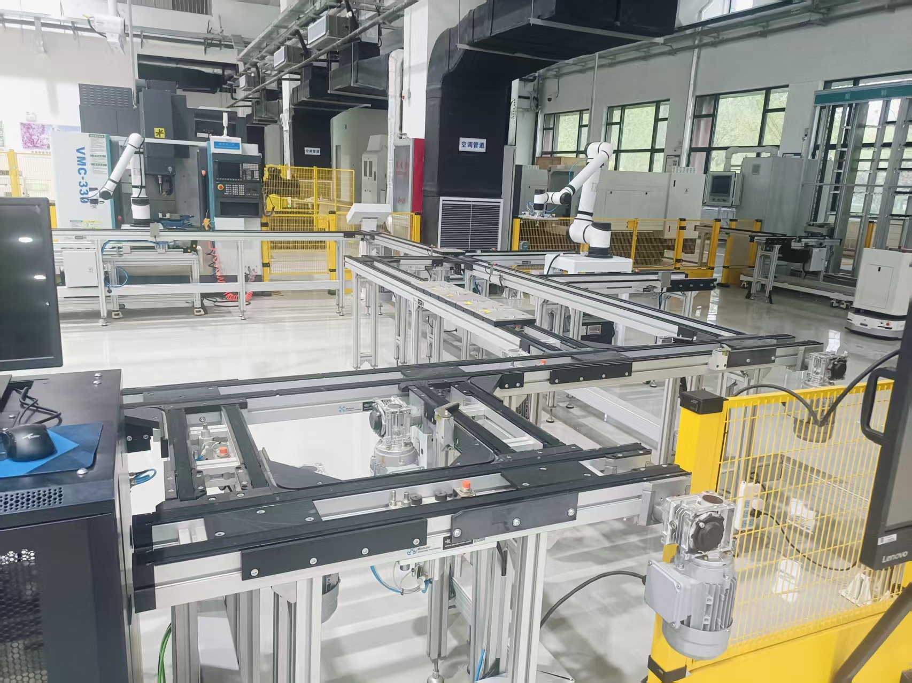

# Vision-Based Electronic Component Sorting System (2026 CXCY Competition)

> 面向电容、连接器、端子三类电子元器件的机器视觉分拣全流程工程：数据采集 → 标注 → 数据集划分 → YOLOv8 训练 → 推理 / 评估 / 置信度统计 → 数字孪生与接口演示。

## 1. 项目简介

本项目是 2026 年创新创业竞赛的机器视觉分拣项目。系统设想的工作过程是：混料由传送带送入视觉识别区，摄像头基于目标检测模型识别元器件的**类型与位置**，机械臂按识别结果将电容、连接器、端子分别放入三个输出通道，最后在通道出口装取货箱。

仓库覆盖的是**视觉算法链路与软件演示**部分：

- 用 PySide6 桌面程序采集摄像头图像；
- 按 YOLO 格式标注三类目标，并完成训练 / 验证 / 测试集划分；
- 用 Ultralytics YOLOv8 训练检测模型；
- 提供图像与摄像头推理、批量精度评估、置信度统计三套桌面工具；
- 提供 Vue 3 + Three.js 的产线数字孪生演示（送货 → 识别 → 机械臂分拣 → 取货）；
- 提供一个 FastAPI 接口雏形。

仓库不包含真实的机械臂、PLC、传送带控制代码；`程序截图.docx` 与 `程序截图-0422.docx` 记录了硬件部署、LabelImg 标注、训练过程、图像/视频推理、3D 场景等界面截图，可作为硬件与流程说明的补充。

## 2. 总体架构 / 流水线

```text
1-data_collect            2-data_annotation          3-dataset-split
  摄像头采集      ──►       YOLO 标签整理      ──►     70 / 15 / 15 划分
                                                          │
                                                          ▼
                                              4-model_training（train.py）
                                              YOLOv8n / YOLO26n 迁移训练
                                                          │
                        ┌─────────────────────────────────┼──────────────────────────────┐
                        ▼                                 ▼                              ▼
              5-model_inference                6-model_evaluation            8-confidence_statistics
              单图 / 摄像头推理                P / R / AP / mAP / F1          置信度分布与阈值分析
                        │                                 │                              │
                        └─────────────────────────────────┴──────────────────────────────┘
                                                          │
                                                          ▼
                                       10-scenario_emonstration（Vue 3 + Three.js 数字孪生）
                                       11-fastapi（HTTP 接口雏形）
```

设计上有两个明显特点：

1. **按流水线编号组织目录**：多数编号目录可以单独运行，便于教学、演示和分阶段提交。
2. **各算法阶段自带一份数据或权重副本**：`5/6/8` 各自保留 `weights/` 和测试数据，避免桌面工具互相依赖；代价是仓库体积偏大、数据存在重复。

## 3. 目录结构

```text
cxcy-2026-vision-sort/
├── 1-data_collect/
│   ├── image_capture.py              # PySide6 + OpenCV 摄像头采集（自动/手动、保存目录、统计）
│   └── images/                       # 采集样张
├── 2-data_annotation/
│   ├── datasets_100/                 # 100 张图 + YOLO txt 标签 + classes.txt
│   ├── datasets_200/                 # 200 张图
│   └── datasets_263/                 # 263 张图（未划分）
├── 3-dataset-split/
│   ├── datasets_split.py             # 数据集划分脚本（复制文件，不破坏原数据）
│   ├── README.md                     # 划分脚本详细说明
│   ├── datasets_100_split/           # 70 / 15 / 15
│   └── datasets_200_split/           # 140 / 30 / 30
├── 4-model_training/
│   ├── train.py                      # YOLOv8 训练入口，自动生成 dataset.yaml
│   ├── README.md                     # 训练参数与常见问题
│   ├── 训练指标说明.md               # 一次训练的 mAP、损失、混淆矩阵分析
│   ├── yolov8n.pt                    # YOLOv8n 预训练权重
│   ├── yolo26n.pt                    # YOLO26n 预训练权重
│   └── datasets_100[_split]/、datasets_200[_split]/
├── 5-model_inference/
│   ├── inference_gui.py              # 单图 / 摄像头推理 GUI
│   ├── images/                       # 50 张演示图
│   ├── results.jpg                   # 推理结果截图
│   └── weights/                      # best_100_45/50/100/500.pt、best_263_500.pt
├── 6-model_evaluation/
│   ├── model_evaluation.py           # 批量评估 GUI（P/R/AP/mAP/F1）
│   ├── datasets_100/                 # 100 张图 + 标签
│   ├── classes.txt
│   └── weights/                      # 6 个 best_*.pt
├── 8-confidence_statistics/
│   ├── confidence_statistics.py      # 置信度统计 / 阈值-指标分析 GUI
│   ├── a.csv                         # 一次评估导出的指标结果
│   ├── datasets_100/
│   └── weights/
├── 9-model_deployment/               # 目前仅 prompt.md，部署环节未实现
├── 10-scenario_emonstration/
│   ├── sorting_line_diagram.html     # 产线 2D 示意图（可直接浏览器打开）
│   ├── scene.jpg                     # 三维场景参考图
│   ├── vision_sort_system_v_cursor/  # Vue 3 + Three.js 版本（含统计面板）
│   ├── vision_sort_system_v_trae/    # Vue 3 + Three.js 版本
│   └── vision_sort_system_v_lingma/  # Vue 3 + Three.js 版本（含 dist.zip 构建产物）
├── 11-fastapi/
│   └── app.py                        # FastAPI /hello 示例
├── 程序截图.docx                     # 数据采集/标注/训练/推理/3D 场景截图
├── 程序截图-0422.docx                # 同上，更新版
├── git.md                            # 推送操作备忘（远端地址请自行替换）
└── .gitignore
```

未随仓库提交的内容：

- `node_modules/`：三个前端目录的依赖，需在本地 `npm install` 生成；
- `4-model_training/runs/`：Ultralytics 训练输出（曲线、日志、checkpoint），体积大且可重新生成。

## 4. 环境与安装

### 4.1 算法 / 桌面端

| 组件 | 建议版本 | 用途 |
|------|----------|------|
| Python | 3.9–3.11（推荐 3.10） | 采集、训练、推理、评估 |
| Ultralytics | 8.x | YOLOv8 / YOLO26 训练与推理 |
| PyTorch | 与 CUDA 匹配的 1.13+ 或 2.x | 训练 / 推理后端 |
| PySide6 | 6.x | 四个桌面 GUI |
| OpenCV | 4.x | 摄像头采集与图像处理 |
| pandas / matplotlib | 近期版本 | 8-confidence_statistics 的统计与绘图 |
| FastAPI / uvicorn | 近期版本 | 11-fastapi |

仓库没有提供 `requirements.txt`，也不锁定版本。可按需安装：

```powershell
python -m venv .venv
.\.venv\Scripts\Activate.ps1
python -m pip install --upgrade pip
pip install ultralytics pyside6 opencv-python pandas matplotlib fastapi uvicorn
```

GPU 训练需先按显卡 CUDA 版本安装对应 PyTorch；无 GPU 时训练和推理均可用 CPU，但速度较慢。

### 4.2 前端演示

`10-scenario_emonstration` 下三个版本都使用 Vite：

- `vision_sort_system_v_cursor`、`vision_sort_system_v_trae` 使用 Vite 8，建议 Node.js 20.19+ / 22.12+；
- `vision_sort_system_v_lingma` 使用 Vite 5，Node.js 18+ 即可。

```powershell
cd 10-scenario_emonstration\vision_sort_system_v_cursor
npm install
npm run dev
```

另外两个版本同理，分别在各自目录执行 `npm install` 与 `npm run dev`。

## 5. 运行方式

以下命令默认从仓库根目录开始，Windows PowerShell 与 cmd 均可；路径中的反斜杠可按需改为 `/`。

### 5.1 图像采集

```powershell
python 1-data_collect\image_capture.py
```

程序功能：

- 选择摄像头（默认 0 号）与保存目录；
- 实时预览；
- 自动采集：设置采集间隔后启动/停止；
- 手动采集：点击一次保存一帧；
- 显示已采集数量、保存路径等状态。

采集文件名形如 `manual_YYYYMMDD_HHMMSS_mmm.jpg`。

### 5.2 数据集划分

```powershell
python 3-dataset-split\datasets_split.py --data-dir 2-data_annotation\datasets_200 --output-dir 3-dataset-split\datasets_200_split
```

默认按 70% / 15% / 15% 划分，随机种子 42；输出目录由 `--output-dir` 指定，省略时会在源目录旁生成 `datasets_200_split/`。脚本复制图片和标签，不移动原文件。比例、输出目录、随机种子均可通过参数调整：

```powershell
python 3-dataset-split\datasets_split.py `
  --data-dir 2-data_annotation\datasets_200 `
  --output-dir 3-dataset-split\datasets_200_split `
  --train-ratio 0.7 --val-ratio 0.15 --test-ratio 0.15 --seed 42
```

### 5.3 模型训练

`train.py` 会根据 `--data-dir` 自动检测 `images/`、`labels/`、`classes.txt` 并生成 `dataset.yaml`：

```powershell
cd 4-model_training
python train.py --data-dir datasets_100_split --epochs 100 --batch 16 --imgsz 640 --device cuda
```

常用参数：

| 参数 | 默认值 | 说明 |
|------|--------|------|
| `--data-dir` | `datasets` | 数据集根目录 |
| `--model` | `yolov8n.pt` | 预训练权重，可换 `yolo26n.pt` 或更大的 YOLOv8 模型 |
| `--epochs` | `1000` | 训练轮数 |
| `--batch` | `16` | 批大小 |
| `--imgsz` | `640` | 输入尺寸 |
| `--device` | `cuda` | `cuda`、`cpu` 或 `0,1` 多卡 |
| `--save-dir` | `models` | 输出目录 |

训练完成后最佳权重通常位于 `models/train/weights/best.pt`，最后一轮为 `last.pt`；曲线、混淆矩阵、PR/F1 曲线等也在同一目录。该输出目录默认未纳入版本控制。

### 5.4 单图 / 摄像头推理

```powershell
python 5-model_inference\inference_gui.py
```

- 模型下拉框读取 `5-model_inference/weights/*.pt`；
- 图片下拉框读取 `5-model_inference/images/*.jpg`，也可手动浏览；
- 支持单图推理、摄像头实时推理、保存标注结果、查看检测框和类别/置信度列表。



### 5.5 批量精度评估

```powershell
python 6-model_evaluation\model_evaluation.py
```

选择模型、图片目录和标签目录后开始评估，界面会显示：

- 总体 Precision、Recall、F1、AP、mAP；
- 各类别 AP / 精确率 / 召回率；
- 推理进度与逐图结果；
- 可导出 CSV 评估报告。

默认目录为 `6-model_evaluation/datasets_100`，标签目录为同级的 `labels/`。

### 5.6 置信度统计

```powershell
cd 8-confidence_statistics
python confidence_statistics.py
```

该工具以**当前工作目录**为基准查找 `weights/` 和图片，因此建议先进入 `8-confidence_statistics` 再运行。功能包括：

- 批量推理并统计每个类别的置信度分布；
- 置信度阈值与 Precision / Recall / F1 的关系；
- 表格与图表展示；
- 导出统计结果（仓库中的 `a.csv` 即一次导出示例）。

### 5.7 数字孪生演示

```powershell
cd 10-scenario_emonstration\vision_sort_system_v_cursor
npm install
npm run dev
```

浏览器打开 Vite 输出的地址（通常为 `http://localhost:5173`）。`vision_sort_system_v_lingma` 在 `vite.config.js` 中固定为 3000 端口并自动打开浏览器。

三个版本都实现“传送带送货 → 摄像头识别 → 机械臂抓取分拣 → 三通道出料/装箱”的三维动画，并提供开始、暂停、继续、停止和分类统计。`vision_sort_system_v_cursor` 的统计面板固定在右侧栏顶部，机械臂采用抓取-放置动作。

也可以直接打开二维产线示意图：

```powershell
start 10-scenario_emonstration\sorting_line_diagram.html
```



### 5.8 FastAPI 接口雏形

```powershell
pip install fastapi uvicorn
python 11-fastapi\app.py
```

启动后访问 `http://127.0.0.1:83/hello`，返回：

```json
{"message": "你好"}
```

端口 83 在 `app.py` 中硬编码；如被占用或无权限，请在源码中改为其他端口。该接口目前只是脚手架，尚未接入模型推理。

## 6. 数据与模型 / 权重说明

### 6.1 类别定义

`classes.txt` 中三行依次为：

```text
capacitor
connector
terminal
```

对应标签 ID `0/1/2`，即电容、连接器、端子。`训练指标说明.md` 中使用了 `dr/dz/ljq` 简称；从 `5-model_inference/results.jpg` 的标注看，`dr` 对应电容、`dz` 对应连接器、`ljq` 对应端子。

### 6.2 数据集规模

对 `2-data_annotation` 下的标签逐行统计（每张图 3 个目标框）：

| 数据集 | 图片数 | 标注框总数 | 类别 0 / 1 / 2 | 已划分结果 |
|--------|--------|------------|----------------|------------|
| `datasets_100` | 100 | 300 | 99 / 100 / 101 | 70 / 15 / 15 |
| `datasets_200` | 200 | 600 | 199 / 200 / 201 | 140 / 30 / 30 |
| `datasets_263` | 263 | 789 | 262 / 263 / 264 | 未划分 |

标签为 YOLO 格式：`class_id x_center y_center width height`，坐标已归一化。

### 6.3 权重清单

| 权重文件 | 所在目录 | 备注 |
|----------|----------|------|
| `best_100_40.pt` | `6-model_evaluation/weights/`、`8-confidence_statistics/weights/` | 100 张数据训练 |
| `best_100_45.pt` | `5/6/8` 的 `weights/` | 100 张数据训练 |
| `best_100_50.pt` | `5/6/8` 的 `weights/` | 100 张数据训练 |
| `best_100_100.pt` | `5/6/8` 的 `weights/` | 100 张数据训练 |
| `best_100_500.pt` | `5/6/8` 的 `weights/` | 100 张数据训练 |
| `best_263_500.pt` | `5/6/8` 的 `weights/` | 263 张数据训练 |
| `yolov8n.pt` | `4-model_training/` | YOLOv8n 预训练权重 |
| `yolo26n.pt` | `4-model_training/` | YOLO26n 预训练权重 |

文件名采用 `best_<数据规模>_<轮次>` 形式的编号（如 `best_100_500.pt`、`best_263_500.pt`）；仓库未保留 `runs/` 训练日志，具体训练参数无法从仓库完整核对。

### 6.4 已记录的指标

仓库内有两条不同来源的指标记录，**不是同一次评估，不能直接互相比较**：

- `4-model_training/训练指标说明.md`：一次训练记录 mAP@0.5 ≈ 0.995，Precision / Recall 收敛到 1.0，三类实例数为 262 / 263 / 264；并记录置信度 0.967 时 Precision 为 1.0、置信度 0.857 时 F1 达到峰值 1.0。
- `8-confidence_statistics/a.csv`：一次评估导出结果为 Precision = Recall = F1 = 0.9967，mAP = 0.9694，TP / FP / FN = 299 / 1 / 1；分类别 AP 为 `capacitor` 0.9991、`connector` 1.0000、`terminal` 0.9091。

## 7. 已知限制

1. **部署环节未落地**：`9-model_deployment/` 只有需求说明 `prompt.md`，没有可运行的部署脚本、Dockerfile、ONNX/TensorRT 导出或服务化代码。
2. **FastAPI 只是雏形**：`11-fastapi/app.py` 仅提供 `/hello`，没有模型加载、上传图片、推理接口，也没有与前端联调。
3. **数据配置含绝对路径**：`4-model_training/datasets_*/dataset.yaml` 的 `path` 是作者机器的绝对路径，换机器后必须修改或让 `train.py` 重新生成。
4. **无依赖清单**：没有 `requirements.txt` / `pyproject.toml`，Python 与前端依赖版本均未锁定。
5. **训练输出缺失**：`runs/` 未提交，训练曲线、日志和 checkpoint 需重新训练生成；仓库内只有最终权重。
6. **数据重复**：`2/3/4/6/8` 多个目录各放了一份图片和标签，仓库体积较大；修改数据集时容易不同步。
7. **标注环节没有代码**：`2-data_annotation/` 只有标注结果，没有标注工具或转换脚本；截图显示使用的是外部 LabelImg。
8. **编号不连续 / 多版本并存**：没有 `7-*` 目录；`10-scenario_emonstration` 下同时保留 cursor、trae、lingma 三个实现，功能重叠，尚未合并为统一入口。
9. **默认参数偏重**：`train.py` 默认 `epochs=1000`、`device=cuda`；无 GPU 或只想快速验证时需显式改成 CPU 和较小轮数。
10. **8-confidence_statistics 依赖工作目录**：脚本用 `os.getcwd()` 查找 `weights/`，不在该目录下启动会找不到模型。
11. **推理界面缺少类别文件**：`5-model_inference/` 下没有 `classes.txt`，推理 GUI 会回退显示 `Class 0/1/2`；如需显示 `capacitor/connector/terminal`，请从其他阶段复制一份 `classes.txt`。
12. **工程化不足**：没有自动化测试、CI、统一日志和配置管理；`git.md` 只是推送备忘，其中的远端地址需要替换为自己的仓库。
13. **数据与模型仅用于竞赛/教学演示**：样本为桌面场景下的三类小目标，未验证工业现场的光照、遮挡、传送带速度变化等条件。

## 8. 相关文档

- [数据集划分工具说明](3-dataset-split/README.md)
- [模型训练工具说明](4-model_training/README.md)
- [训练指标分析](4-model_training/训练指标说明.md)
- [Cursor 版数字孪生说明](10-scenario_emonstration/vision_sort_system_v_cursor/README.md)
- [Lingma 版数字孪生说明](10-scenario_emonstration/vision_sort_system_v_lingma/README.md)
- `程序截图.docx`、`程序截图-0422.docx`：数据采集、标注、训练、推理、评估、3D 场景的界面截图
